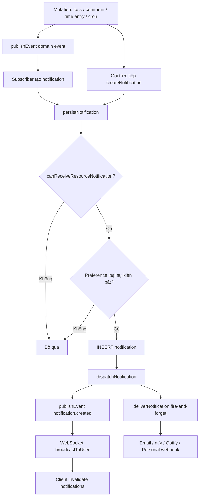
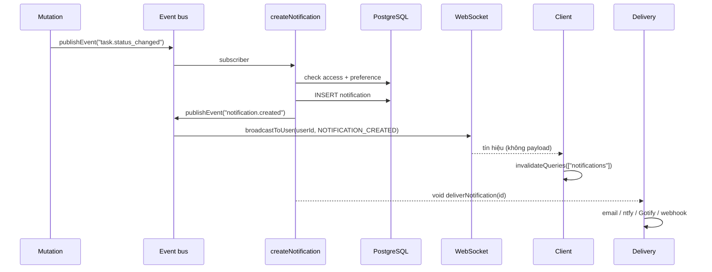
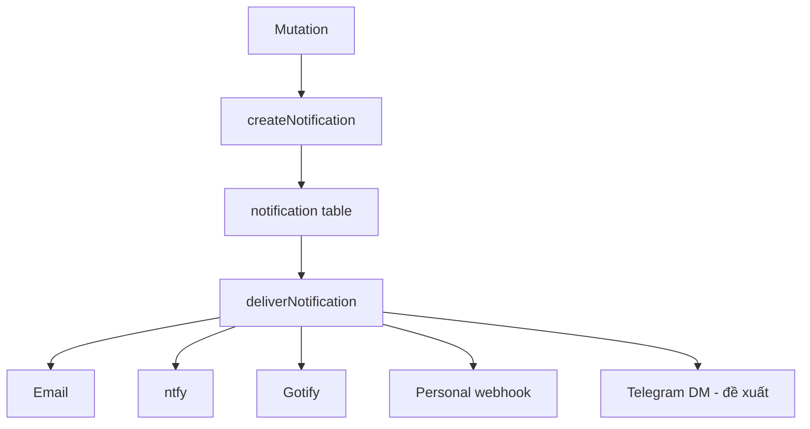

# Đánh giá cơ chế thông báo của Kaneo

> **Loại:** artifact review (read-only)
> **Branch:** `notification-review`
> **Ngày:** 2026-11-08
> **Phạm vi:** mô tả và đánh giá cách Kaneo tạo, lưu, đẩy realtime và gửi thông báo ra kênh ngoài. Mục 17-20 ghi lại thiết kế đề xuất cho thông báo Telegram theo từng user và vai trò của webhook. Tài liệu này không thay đổi hành vi nào của hệ thống.

---

## 1. Tóm tắt điều hành

Kaneo có **hai hệ thống thông báo tách biệt**, dễ nhầm với nhau:

| Hệ thống | Đối tượng | Lưu trữ | Cấu hình |
| --- | --- | --- | --- |
| **Inbox notification** (cá nhân) | Từng user | Bảng `notification` | Settings → Account → Notifications |
| **Project integration** (nhóm) | Cả project/kênh | Không dùng bảng `notification` | Settings → Projects → Integrations |

Artifact này tập trung vào **inbox notification**. Điểm cốt lõi:

- **Inbox là nguồn sự thật.** Notification luôn được ghi vào PostgreSQL trước khi làm bất cứ việc gì khác.
- **Realtime chỉ là tín hiệu.** WebSocket gửi `NOTIFICATION_CREATED` không kèm nội dung; client tự refetch danh sách.
- **External delivery là best-effort.** Email/ntfy/Gotify/webhook chạy nền, không retry, không queue; lỗi gửi ngoài không làm mất notification trong inbox.
- **Quyền đọc được kiểm tra lại tại thời điểm đọc**, không tin `eventData` hay dữ liệu do integration cung cấp.

---

## 2. Kiến trúc tổng quát



### Luồng tuần tự



---

## 3. Vòng đời một notification

### 3.1. Tạo

`apps/api/src/notification/controllers/create-notification.ts`

```ts
persistNotification()  // kiểm tra quyền + preference, INSERT
dispatchNotification() // realtime + external delivery
createNotification()   // gộp hai bước trên
```

`persistNotification()` thực hiện theo thứ tự:

1. **Kiểm tra người nhận có quyền nhận resource hay không** bằng `canReceiveResourceNotification()`.
2. **Áp preference theo loại sự kiện** (nếu user đã có row preference).
3. **INSERT** vào bảng `notification` với `isRead = false`.

Nếu bước 1 hoặc 2 thất bại, hàm trả `null` và **không có notification nào được tạo**.

### 3.2. Preference theo loại sự kiện

| Loại notification | Toggle áp dụng |
| --- | --- |
| `task_created` | `taskAssignmentEnabled` |
| `task_assignee_changed` | `taskAssignmentEnabled` |
| `task_comment` | `taskCommentEnabled` |
| `task_mention` | `taskCommentEnabled` |
| `task_status_changed` | `taskStatusChangeEnabled` |
| `due_date_reminder` | `dueDateReminderEnabled` |
| `task_overdue` | `dueDateReminderEnabled` |
| `workspace_created` | Không có toggle |
| `time_entry_created` | Không có toggle |
| `info` | Không có toggle |

Lưu ý: nếu user **chưa có row** `user_notification_preference`, tất cả loại đều được tạo (chỉ chặn khi giá trị là `false`).

### 3.3. Dispatch

`dispatchNotification()` làm hai việc:

```ts
await publishEvent("notification.created", { notificationId, userId });
void deliverNotification(notification.id).catch(log);
```

- `publishEvent` được **await** để đảm bảo realtime signal phát ra trước khi response trả về.
- `deliverNotification` **không await**; lỗi chỉ được log.

---

## 4. Nguồn phát sinh thông báo

| Nguồn | File | Người nhận | Điều kiện |
| --- | --- | --- | --- |
| Task được tạo | `apps/api/src/notification/index.ts` | Assignee (`task.userId`) | Khác người tạo (`currentUserId`) |
| Workspace được tạo | `apps/api/src/notification/index.ts` | Owner (`ownerId`) | Có `ownerId` |
| Task đổi trạng thái | `apps/api/src/notification/index.ts` | Assignee | Có assignee và khác actor |
| Task đổi assignee | `apps/api/src/notification/index.ts` | Assignee mới | Khác actor |
| Time entry được tạo | `apps/api/src/notification/index.ts` | Chủ task (`taskOwnerId`) | Khác người tạo time entry |
| @mention trong comment | `apps/api/src/activity/controllers/create-comment.ts` | Từng user được mention | Loại trừ tác giả comment |
| Comment mới trên task | `apps/api/src/activity/controllers/create-comment.ts` | Assignee | Assignee khác tác giả và chưa được mention trong cùng comment |
| @mention mới trong description | `apps/api/src/task/controllers/task-mutation-effects.ts` | User được mention | Chỉ mention **mới thêm**, loại trừ người sửa |
| Due-date reminder | `apps/api/src/scheduler/due-date-reminders.ts` | Assignee | Cron, xem mục 10 |
| Overdue | `apps/api/src/scheduler/due-date-reminders.ts` | Assignee | Cron, xem mục 10 |
| API tạo thủ công | `POST /api/notification` | Chính user gọi API | Dành cho integration/tích hợp nội bộ |

### Event data tương ứng

| Loại | `eventData` |
| --- | --- |
| `task_created` | `taskTitle`, `projectId`, `workspaceId` |
| `workspace_created` | `workspaceName` |
| `task_status_changed` | `taskTitle`, `oldStatus`, `newStatus`, `projectId`, `workspaceId` |
| `task_assignee_changed` | `taskTitle`, `projectId`, `workspaceId` |
| `time_entry_created` | `taskTitle`, `projectId`, `workspaceId` |
| `task_mention` (comment) | `taskTitle`, `mentionerName`, `projectId`, `workspaceId` |
| `task_comment` | `taskTitle`, `commenterName`, `commentPreview`, `projectId`, `workspaceId` |
| `task_mention` (description) | `taskTitle`, `mentionerName` |
| `due_date_reminder` | `taskTitle`, `reminderType`, `leadTimeMinutes`, `dueDate` |
| `task_overdue` | `taskTitle`, `reminderType`, `leadTimeMinutes`, `dueDate` |

> `resourceId` / `resourceType` luôn trỏ tới task hoặc workspace thật. Client dùng cặp này để mở đúng màn hình, không dựa vào `eventData`.

---

## 5. Mô hình dữ liệu

### 5.1. `notification`

`apps/api/src/database/schema.ts`

| Cột | Ý nghĩa |
| --- | --- |
| `id` | CUID2 |
| `userId` | Người nhận |
| `title`, `content` | Text tùy chọn; notification sinh tự động thường để `null` và client render từ `type + eventData` |
| `type` | `info`, `task_created`, `workspace_created`, `task_status_changed`, `task_assignee_changed`, `time_entry_created`, `due_date_reminder`, `task_overdue`, `task_mention`, `task_comment` |
| `eventData` | JSONB payload theo loại |
| `isRead` | Mặc định `false` |
| `resourceId`, `resourceType` | `task` hoặc `workspace` |
| `createdAt`, `updatedAt` | Timestamp |

Index: `notification_userId_idx`.

### 5.2. `user_notification_preference` (global, 1 row/user)

- Bật/tắt kênh: `emailEnabled`, `ntfyEnabled`, `gotifyEnabled`, `webhookEnabled`.
- Credential: `emailAddress` lấy từ user; `ntfyServerUrl`, `ntfyTopic`, `ntfyToken`; `gotifyServerUrl`, `gotifyToken`; `webhookUrl`, `webhookSecret`.
- Toggle sự kiện: `taskAssignmentEnabled`, `taskCommentEnabled`, `taskStatusChangeEnabled`, `dueDateReminderEnabled`.
- `dueDateReminderLeadTimeMinutes` — mặc định `1440` (1 ngày).

### 5.3. `user_notification_workspace_rule` (1 row/user/workspace)

- `isActive` — rule có hiệu lực hay không.
- Bật/tắt từng kênh theo workspace.
- `projectMode`: `all` hoặc `selected`.
- Unique `(userId, workspaceId)`.

### 5.4. `user_notification_workspace_project`

- Danh sách project được chọn khi `projectMode = "selected"`.

### 5.5. `task_reminder_sent`

- `taskId`, `reminderType` (`configured_before` | `overdue`).
- Unique `(taskId, reminderType)` dùng để chống gửi trùng.

---

## 6. Realtime

### Server

`apps/api/src/ws/index.ts`

```ts
subscribeToEvent("notification.created", async (data) => {
  if (data.userId) {
    broadcastToUser(data.userId, { type: "NOTIFICATION_CREATED" });
  }
});
```

- Gửi tới các connection local của user.
- Nếu Redis được cấu hình, `RedisBroadcastAdapter` fan-out giữa các API instance.
- Redis **không bắt buộc**: một instance vẫn hoạt động bình thường.
- Message **không chứa payload** (không title, content, type).

### Web

`apps/web/src/hooks/use-user-websocket.ts`

- Nhận `NOTIFICATION_CREATED` → `invalidateQueries({ queryKey: ["notifications"] })`.
- Sidebar badge đếm unread từ danh sách đã fetch.

### Mobile

- Foreground: nhận cùng WebSocket event và invalidate query.
- Background: **không có push service**. App dùng `expo-background-task` để poll `GET /api/notification` (OS chạy tối đa khoảng 15 phút/lần), lọc unread mới hơn mốc đã lưu, rồi đăng **local notification** (tối đa 5, phần dư gộp thành summary).
- Tap notification mở task qua `taskId`.

### CLI

`packages/cli/src/api/notifications.ts`: list, mark read, mark all read.

---

## 7. External delivery

`apps/api/src/notification-preferences/delivery.ts`

### 7.1. Điều kiện gửi

`deliverNotification(notificationId)` chỉ gửi khi **tất cả** điều kiện sau đúng:

1. Notification còn tồn tại.
2. User vẫn có quyền nhận resource (`canReceiveResourceNotification`).
3. Resolve được context:
   - `task` → task + project + workspace + task URL.
   - `workspace` → workspace.
   - Resource bị xóa/không hỗ trợ → **chỉ nằm trong inbox**.
4. User tồn tại.
5. User có row `user_notification_preference`.
6. Có `user_notification_workspace_rule` **đang active** cho workspace đó.
7. Nếu `projectMode = "selected"`, project của notification phải nằm trong danh sách chọn.
8. Kênh phải bật ở **cả hai tầng**: global preference **và** workspace rule.
9. Credential của kênh phải đầy đủ.

> Chỉ bật kênh global là **chưa đủ**. Phải có workspace rule active và bật kênh ở rule đó.

### 7.2. Các kênh

| Kênh | Điều kiện thêm | Chi tiết |
| --- | --- | --- |
| **Email** | `emailEnabled` global + rule, user có email, SMTP đã cấu hình | Template localized theo `user.locale`, có task card, breadcrumb workspace/project, nút mở task và link settings |
| **ntfy** | `ntfyServerUrl` + `ntfyTopic` (+ token tùy chọn) | `Authorization: Bearer`; `Click` trỏ task URL; title non-ASCII được encode RFC 2047 |
| **Gotify** | `gotifyServerUrl` + `gotifyToken` | Token nằm trong query string `?token=` (có rủi ro lộ qua log/proxy); priority 5; click URL trong `extras` |
| **Personal webhook** | `webhookUrl` (+ secret tùy chọn) | JSON POST; ký `X-Kaneo-Signature` = HMAC-SHA256 hex của raw body |

Email: nếu SMTP chưa cấu hình, `sendNotificationEmail` trả `{ success: false, reason: "SMTP_NOT_CONFIGURED" }` thay vì throw.

### 7.3. Webhook payload

```json
{
  "notification": {
    "id": "...",
    "type": "task_comment",
    "title": "...",
    "content": "...",
    "createdAt": "...",
    "eventData": {},
    "resourceId": "...",
    "resourceType": "task"
  },
  "workspace": { "id": "...", "name": "..." },
  "project": { "id": "...", "name": "..." },
  "task": { "id": "...", "title": "...", "url": "..." },
  "user": { "id": "...", "email": "...", "name": "..." }
}
```

`project` và `task` là `null` khi notification gắn với workspace.

`notification.title` và `notification.content` trong payload là **nội dung đã render** theo loại sự kiện (cùng nội dung dùng cho email/ntfy/Gotify), không phải raw `title`/`content` lưu trong DB. `notification.eventData` vẫn là dữ liệu gốc.

### 7.4. Bảo mật

- **Secret at rest:** AES-256-GCM, prefix `enc:v1:`, key = SHA-256 của `NOTIFICATION_SECRET_ENCRYPTION_KEY`. API chỉ trả masked preview, không trả secret đầy đủ.
- **SSRF:** URL đích được kiểm tra bằng `assertPublicWebhookDestination` → `assertPublicDestination`.
- **Ngoại lệ private network:** đặt `KANEO_ALLOW_PRIVATE_WEBHOOK_DESTINATIONS=true` (hoặc `1`) khi self-host trong mạng nội bộ.
- **Lỗi gửi:** `Promise.allSettled`, chỉ log; không retry, không queue, không rollback notification.

---

## 8. Mô hình preference và cascade

`apps/api/src/notification-preferences/service.ts`

- **Tắt kênh global** → tự động tắt kênh đó ở các workspace rule đang active.
- **Bật kênh global lần đầu** → tự động bật kênh đó ở các rule đang active nếu đã đủ credential.
- **Bật kênh ở workspace rule** yêu cầu kênh global đã bật và đã cấu hình; nếu không, API trả `400`.
- **Chọn project** được validate theo quyền hiện tại; project không accessible bị loại bỏ.
- Toggle sự kiện (assignment/comment/status/due date) là **global**, không có override theo workspace.

### API

| Method | Path | Mục đích |
| --- | --- | --- |
| `GET` | `/api/notification-preferences` | Đọc preference global + rules |
| `PUT` | `/api/notification-preferences` | Cập nhật preference global |
| `PUT` | `/api/notification-preferences/workspaces/:workspaceId` | Tạo/cập nhật rule |
| `DELETE` | `/api/notification-preferences/workspaces/:workspaceId` | Xóa rule |

---

## 9. Kiểm soát truy cập

`apps/api/src/notification/resource-access.ts`

Dùng chung cho **tạo, list, mark read/unread, delete, clear, delivery**:

- Phải là member workspace.
- Không bị ban.
- Workspace chưa archive.
- Project phải còn accessible (kể cả project-level access).
- Role hiện tại phải cho phép `task:read` hoặc `workspace:read`.
- API key phải có scope tương ứng.

`notificationWorkspaceFilter()` (`apps/api/src/notification/workspace-filter.ts`) resolve workspace **từ resource thật** (task → project → workspace), không dựa vào `eventData` do integration cung cấp.

Nhờ vậy:

- Notification lịch sử vẫn được lọc đúng khi quyền thay đổi.
- User bị remove khỏi workspace không đọc được notification cũ của workspace đó.
- Workspace archive tạm ẩn notification cho tới khi restore.

### API inbox

| Method | Path | Ghi chú |
| --- | --- | --- |
| `GET` | `/api/notification?workspaceId=` | Tối đa **50** item gần nhất, không phân trang |
| `POST` | `/api/notification` | Tạo notification cho chính user gọi |
| `PATCH` | `/api/notification/:id/read` | Đánh dấu đã đọc |
| `PATCH` | `/api/notification/:id/unread` | Đánh dấu chưa đọc |
| `PATCH` | `/api/notification/read-all?workspaceId=` | Đọc tất cả |
| `DELETE` | `/api/notification/:id` | Xóa một |
| `DELETE` | `/api/notification/clear-read?workspaceId=` | Xóa các item đã đọc |
| `DELETE` | `/api/notification/clear-all?workspaceId=` | Xóa tất cả |

---

## 10. Due-date reminder

`apps/api/src/scheduler/due-date-reminders.ts` + `reminder-timing.ts`

- Cron: `*/5 * * * *` (mỗi 5 phút).
- Cửa sổ: **10 phút** cho mỗi loại.
- `due_date_reminder`: khi `dueDate + 24h - leadTime` rơi vào cửa sổ hiện tại.
- `task_overdue`: khi `dueDate + 24h` vừa đi qua trong 10 phút gần nhất.
- `dueDate` được lưu như mốc đầu ngày; `DUE_DATE_DURATION_MS = 24h` là xấp xỉ (DST có thể 23/25 giờ — xem issue #1783 trong code).

### Điều kiện loại trừ

- Task không có assignee.
- Task không có due date.
- Task ở column `isFinal = true` (đã hoàn thành).
- Task có `status = "archived"`.
- Workspace đã archive.
- User tắt `dueDateReminderEnabled`.
- Đã gửi reminder cùng loại trước đó.

### Chống trùng

1. Trong transaction, insert claim vào `task_reminder_sent` với `onConflictDoNothing`.
2. Nếu claim không được tạo → đã gửi rồi, bỏ qua.
3. `persistNotification` chạy trong cùng transaction.
4. Nếu không tạo được notification (ví dụ mất quyền), xóa claim để lần chạy sau thử lại.
5. Sau khi commit mới `dispatchNotification`.

Đổi due date sẽ xóa toàn bộ claim cũ của task (`recordTaskMutation`), cho phép reminder chạy lại theo mốc mới.

---

## 11. Phía client

### Web

- Inbox: `/dashboard/workspace/:workspaceId/inbox`.
- Filter: `all` / `unread` / `mentions`.
- Nhóm: `today` / `earlier`.
- Hành động: mark read/unread, clear read, clear all, delete.
- Sidebar badge đếm unread.
- Nội dung notification được render từ `type + eventData` qua i18n (`apps/web/src/components/notification/notification-text.ts`), không phụ thuộc `title`/`content` server.

### Mobile

- `apps/mobile/src/lib/background.ts`: poll + local notification, không có push thật.
- Foreground: WebSocket invalidate query.
- Tap notification mở task.

### CLI

- `packages/cli/src/api/notifications.ts`: list, mark read, mark all read.
- `NOTIFICATION_PAGE_CAP = 50` khớp với giới hạn server.

---

## 12. Phân biệt với project integration

| Tiêu chí | Personal notification | Project integration |
| --- | --- | --- |
| Phạm vi | Từng user | Cả project |
| Lưu trữ | Bảng `notification` | Không dùng bảng `notification` |
| Cấu hình | Account settings | Project settings → Integrations |
| Kênh | Email, ntfy, Gotify, personal webhook | Slack, Discord, Mattermost, Telegram, generic webhook |
| Preference | Toggle sự kiện + workspace rule | Chọn event + webhook URL |
| Mục đích | "Việc này liên quan tới tôi" | "Báo cho team/kênh" |

Hai hệ thống có thể cùng phát sinh từ một mutation nhưng **không chia sẻ pipeline delivery**.

---

## 13. Đánh giá review

### 13.1. Điểm mạnh

- **Tách bạch rõ** inbox (durable) và external delivery (best-effort).
- **Authorization phòng thủ nhiều lớp**: kiểm tra lúc tạo, lúc đọc, lúc gửi; dùng chung một predicate.
- **Không tin `eventData`** khi lọc workspace; resolve từ resource thật.
- **Preference hai tầng** (global + workspace rule) cho phép kiểm soát mịn theo workspace/project.
- **Secret được mã hóa**, không trả về client.
- **Reminder chống trùng** bằng unique constraint + transaction claim.
- **Redis optional**, giữ được mục tiêu self-host đơn giản.
- **Realtime nhẹ**: chỉ gửi tín hiệu, tránh phải version payload.

### 13.2. Rủi ro và hạn chế

| # | Mức | Vấn đề | Tác động | Đề xuất |
| --- | --- | --- | --- | --- |
| 1 | Cao | External delivery không retry/queue | Mất thông báo ngoài nếu process crash, mạng lỗi, hoặc receiver tạm down | Cân nhắc outbox table + retry có backoff; giữ optional để không phá self-host |
| 2 | Trung bình | Inbox chỉ trả 50 item, không phân trang | User nhiều notification không xem được item cũ | Thêm cursor pagination (`createdAt, id`) |
| 3 | Trung bình | Realtime không payload, mỗi notification gây invalidate | Nhiều notification liên tiếp → nhiều lần refetch | Debounce/coalesce invalidate ở client, hoặc gửi kèm payload tối thiểu |
| 4 | Trung bình | Mobile không có push thật, phụ thuộc background task ~15 phút | Trễ thông báo; iOS có thể hạn chế hơn | Ghi rõ giới hạn trong docs; cân nhắc push service nếu muốn realtime |
| 5 | Trung bình | Gotify token nằm trong query string | Có thể lộ qua log/proxy/history | Đã ghi chú trong code; cân nhắc header nếu Gotify hỗ trợ |
| 6 | Thấp | `workspace_created` và `time_entry_created` không có toggle | User không thể tắt riêng hai loại này | Thêm toggle hoặc gộp vào nhóm hợp lý |
| 7 | Thấp | `task_created` dùng chung toggle với `task_assignee_changed` | Không tắt riêng được "task mới được giao" và "task được tạo" | Tách toggle nếu product cần |
| 8 | Thấp | Secret không có key version | Rotate `NOTIFICATION_SECRET_ENCRYPTION_KEY` làm hỏng dữ liệu cũ | Thêm key id vào prefix (`enc:v2:`) và hỗ trợ đọc nhiều key |
| 9 | Thấp | Comment chỉ notify assignee + mention | Watcher/người theo dõi không nhận thông báo | Xác nhận đây là chủ ý; nếu không, thêm cơ chế watcher |
| 10 | Thấp | `DUE_DATE_DURATION_MS` xấp xỉ 24h | Reminder lệch quanh DST | Đã track #1783; có thể dùng timezone-aware due datetime |
| 11 | Thấp | Rule delivery yêu cầu row preference tồn tại | User chưa từng lưu settings sẽ không nhận kênh ngoài dù đã cấu hình nơi khác | UI nên đảm bảo tạo row khi bật kênh; hoặc tự tạo default row |
| 12 | Thấp | `POST /api/notification` chỉ tạo cho chính mình | Hạn chế cho integration muốn bắn cho user khác | Giữ nguyên vì lý do bảo mật; integration nên dùng webhook/API riêng |

### 13.3. Câu hỏi mở

1. Có cần notification cho **watcher** hoặc **project member** ngoài assignee/mention không?
2. External delivery có cần đảm bảo **at-least-once** không, hay best-effort là đủ?
3. Có cần **per-workspace override** cho toggle sự kiện (hiện chỉ global) không?
4. Mobile có kế hoạch dùng push service thật (FCM/APNs) không?
5. Có cần lưu **delivery log** để user/debug biết kênh nào đã gửi thất bại không?

---

## 14. Test coverage hiện có

| Khu vực | Test |
| --- | --- |
| API integration | `tests/api-integration/notification-*.test.ts` |
| Web render | `apps/web/src/components/notification/notification-text.test.ts` |
| Web grouping | `apps/web/src/components/inbox/group-notifications.test.ts` |
| Email template | `packages/email/src/templates/notification.test.ts` |
| CLI | `packages/cli/src/notifications/*.test.ts` |

Khoảng trống đáng chú ý:

- Chưa thấy test end-to-end cho **delivery retry/failure** (vì không có retry).
- Chưa thấy test cho **preference cascade** ở mức integration đầy đủ (global ↔ rule).
- Chưa thấy test cho **WebSocket fan-out qua Redis** trong notification path.

---

## 15. Biến môi trường liên quan

| Biến | Dùng cho |
| --- | --- |
| `DATABASE_URL` | PostgreSQL |
| `AUTH_SECRET` | Auth chung |
| `KANEO_CLIENT_URL` | Link task/settings trong email, ntfy, Gotify, webhook |
| `NOTIFICATION_SECRET_ENCRYPTION_KEY` | Mã hóa ntfy/Gotify/webhook secret |
| `KANEO_ALLOW_PRIVATE_WEBHOOK_DESTINATIONS` | Cho phép webhook tới private network |
| `SMTP_HOST`, `SMTP_PORT`, `SMTP_USER`, `SMTP_PASSWORD`, `SMTP_FROM`, `SMTP_SECURE`, `SMTP_REQUIRE_TLS` | Gửi email |
| `REDIS_URL`, `REDIS_SENTINELS`, hoặc `REDIS_CLUSTER_NODES` | Fan-out WebSocket giữa các instance (optional) |

---

## 16. Bản đồ file

```
apps/api/src/
├── notification/
│   ├── index.ts                     # routes + event subscribers
│   ├── resource-access.ts           # authorization dùng chung
│   ├── workspace-filter.ts          # lọc workspace từ resource
│   ├── response.ts                  # schema response
│   ├── schema.ts                    # schema request
│   └── controllers/
│       ├── create-notification.ts   # persist + dispatch
│       ├── get-notifications.ts     # list, limit 50
│       ├── set-notification-read.ts
│       ├── mark-all-notifications-as-read.ts
│       ├── delete-notification.ts
│       └── clear-notifications.ts
├── notification-preferences/
│   ├── index.ts                     # routes
│   ├── service.ts                   # preference + cascade
│   ├── delivery.ts                  # email/ntfy/Gotify/webhook
│   ├── secrets.ts                   # AES-256-GCM
│   ├── resolve-email-task.ts
│   └── schema.ts
├── activity/controllers/create-comment.ts
├── task/controllers/task-mutation-effects.ts
├── scheduler/
│   ├── due-date-reminders.ts
│   └── reminder-timing.ts
├── events/index.ts                  # in-process event bus
├── ws/index.ts                      # WebSocket + Redis adapter
├── plugins/
│   ├── telegram/                    # project Telegram integration
│   └── generic-webhook/             # project generic webhook
└── database/schema.ts               # notification + preference tables

apps/web/src/
├── hooks/use-user-websocket.ts
├── components/inbox/
└── components/settings/notifications/

apps/mobile/src/
├── lib/background.ts
└── app/(app)/index.tsx

packages/cli/src/
├── api/notifications.ts
└── notifications/
```

---

## 17. Thông báo Telegram cho từng user

### 17.1. Hiện trạng

Telegram hiện **chỉ tồn tại dưới dạng project integration**, không phải kênh thông báo cá nhân. Không có cột Telegram nào trong preference, không có UI cấu hình Telegram theo user, và delivery pipeline không có nhánh Telegram.

Bằng chứng:

| Khu vực | Trạng thái |
| --- | --- |
| `user_notification_preference` | Chỉ có `emailEnabled`, `ntfyEnabled`, `gotifyEnabled`, `webhookEnabled` (`apps/api/src/database/schema.ts:1009`) |
| Request schema | Không có `telegramEnabled` / `telegramChatId` (`apps/api/src/notification-preferences/schema.ts`) |
| Response schema | Không trả thông tin Telegram (`apps/api/src/notification-preferences/response.ts`) |
| Delivery | Chỉ email, ntfy, Gotify, personal webhook (`apps/api/src/notification-preferences/delivery.ts:485-554`) |
| UI | Chỉ 4 kênh (`apps/web/src/components/settings/notifications/get-channel-availability.ts`) |
| Project Telegram | `integration` unique `(projectId, type)` (`apps/api/src/database/schema.ts:1215`) |

Project Telegram dùng **một** `botToken` + **một** `chatId` (+ `threadId`, `chatLabel`, `events`) cho cả project (`apps/api/src/plugins/telegram/config.ts:34-40`). Mọi message đều gửi tới `chatId` đó.

Các event Telegram đang hỗ trợ (`apps/api/src/plugins/telegram/config.ts:3-10`):

| Event | Mặc định |
| --- | --- |
| `taskCreated` | Bật |
| `taskStatusChanged` | Bật |
| `taskPriorityChanged` | Tắt |
| `taskTitleChanged` | Tắt |
| `taskDescriptionChanged` | Tắt |
| `taskCommentCreated` | Bật |

**Không có `taskAssigneeChanged`.** Plugin interface có khai báo `onTaskAssigneeChanged` (`apps/api/src/plugins/types.ts:162`), generic webhook có đăng ký (`apps/api/src/plugins/generic-webhook/index.ts:29`), nhưng Telegram plugin không đăng ký handler (`apps/api/src/plugins/telegram/index.ts:12-22`).

Hệ quả:

- Task tạo kèm assignee → có message "New task created" vào chat chung, **không phải DM cho assignee**, và message không hiển thị assignee.
- Task được giao lại → **không có message Telegram nào**.
- Task đổi trạng thái → có message vào chat chung, không phải DM.

### 17.2. Đối chiếu kịch bản mong muốn

| Yêu cầu | Hiện trạng |
| --- | --- |
| Task được giao → Telegram cho assignee | ❌ Không có Telegram per-user. Assignee có inbox notification và có thể nhận email/ntfy/Gotify/webhook. |
| Task được giao → Telegram cho người giao việc | ❌ Không có notification nào cho người giao việc (tạm hoãn theo scope). |
| Task đổi trạng thái → Telegram cho assignee | ❌ Không có Telegram per-user. Assignee có inbox notification. |
| Task đổi trạng thái → Telegram cho người giao việc | ❌ Không có notification cho người giao việc (tạm hoãn theo scope). |
| Thông báo Telegram vào group chung của project | ✅ Có, nhưng chỉ với các event đã bật và không có assignment event. |

Task **không có cột `createdBy` / `assignedById`** (`apps/api/src/database/schema.ts:685-734`). Người giao việc chỉ tồn tại tạm thời trong event/activity, nên muốn thông báo lâu dài cho họ cần lưu thêm dữ liệu hoặc tạo notification ngay tại thời điểm assign.

### 17.3. Mô hình đề xuất: bot chung cho project, bot instance cho cá nhân

Tách hai luồng là hợp lý vì phạm vi và đối tượng khác nhau:

| Luồng | Bot | Đích | Mục đích |
| --- | --- | --- | --- |
| Project channel | Bot hiện có của project | `chatId` của group/channel | "Báo cho team/kênh" |
| Personal notification | **Một bot cấp instance** | `chatId` của từng user | "Việc này liên quan tới tôi" |

Điểm quan trọng: **"bot cá nhân" nên hiểu là bot của instance dùng để DM từng user**, không phải mỗi user tự tạo bot. Cái "cá nhân" nằm ở `chatId`, không nằm ở bot token.

| Cách làm | Ưu điểm | Nhược điểm |
| --- | --- | --- |
| Mỗi user một bot | Cảm giác riêng tư, tên bot riêng | N token, N secret, rotate/validate phức tạp, UX nặng |
| Một bot instance + `chatId` từng user | Đơn giản, an toàn, dễ self-host | User phải `/start` bot một lần |
| Hai bot instance (project + personal) | Tách luồng rõ ràng | Thêm một token/env, gần như không đáng kể |

Khuyến nghị: giữ nguyên project bot; thêm **một personal bot cấp instance** qua biến môi trường (ví dụ `TELEGRAM_PERSONAL_BOT_TOKEN`) và lưu `telegramChatId` theo từng user. Bot token là secret cấp instance; `chatId` chỉ là định danh, không cần mã hóa.

Telegram cho phép một bot DM nhiều user, miễn là user đó đã bấm `/start` với bot. Đây là giới hạn của Telegram, không phải của Kaneo.

### 17.4. Đưa Telegram vào pipeline delivery hiện có

Thông báo cá nhân **không nên là một pipeline gửi thẳng riêng**. Nó nên là **một kênh delivery mới** của inbox notification:



Lợi ích:

- Thừa hưởng kiểm tra quyền `canReceiveResourceNotification`.
- Thừa hưởng preference global + workspace rule + project selection.
- Inbox vẫn là nguồn sự thật; Telegram chỉ là kênh phụ.
- Không tạo thêm một hệ notification song song.

Thay đổi cần thiết:

**Data model**

- `user_notification_preference`: `telegramEnabled`, `telegramChatId`, (tuỳ chọn) `telegramLinkedAt`.
- `user_notification_workspace_rule`: `telegramEnabled`.
- Migration Drizzle, kiểm tra SQL và tương thích với installation hiện có.

**Delivery**

- Thêm `sendTelegramNotification` trong `apps/api/src/notification-preferences/delivery.ts`, dùng lại `postToTelegram` (`apps/api/src/plugins/telegram/client.ts`).
- Điều kiện gửi giống các kênh khác:
  - global `telegramEnabled`;
  - workspace rule active và `telegramEnabled`;
  - có `telegramChatId`;
  - project nằm trong `selectedProjectIds` nếu rule dùng `projectMode = "selected"`.
- Nội dung dùng lại `buildDeliveryContent` để thống nhất với email/ntfy/Gotify, kèm `taskUrl` nếu có.

**API + UI**

- Thêm `telegramEnabled`, `telegramChatId` vào request/response schema.
- Thêm mục Telegram trong **Account → Notifications**.
- Thêm i18n (en-US là nguồn).
- Nếu làm linking tự động: thêm endpoint nhận `/start <token>` từ Telegram webhook (xem 18.5).

### 17.5. Phạm vi "task được update"

Cần chốt nghĩa của "task được update" trước khi triển khai, vì gửi Telegram cho **mọi** field change sẽ gây spam.

| Sự kiện | Notification type hiện có | Ghi chú |
| --- | --- | --- |
| Task mới được giao cho tôi | `task_assignee_changed` | Đã có |
| Task mới tạo và giao cho tôi | `task_created` | Đã có |
| Task đổi trạng thái | `task_status_changed` | Đã có |
| Comment / @mention | `task_comment`, `task_mention` | Đã có |
| Due date / overdue | `due_date_reminder`, `task_overdue` | Đã có |
| Đổi priority / title / description / due date | **Chưa có notification** | Nên cân nhắc vì rất ồn |
| Được mời / thêm vào workspace | **Chưa có** | Cần thêm notification type |
| Được cấp quyền vào project | **Chưa có** | Cần thêm notification type |

Khuyến nghị:

- **Không** gửi Telegram cho mọi field change.
- Nếu cần priority/title/description, thêm toggle riêng hoặc gộp thành digest.
- Giữ nguyên bộ toggle sự kiện hiện có, chỉ thêm kênh Telegram.

### 17.6. "Được mời vào dự án mới"

Kaneo có hai khái niệm khác nhau:

1. **Invitation vào workspace** — bảng `invitation` (`apps/api/src/database/schema.ts:439-464`), gửi email mời; user accept thì thành member.
2. **Cấp quyền vào project** — `workspace_member_project`, phát `project_access.updated`.

Hiện **không có notification nào** cho cả hai. Muốn Telegram báo "bạn được mời vào dự án mới", cần:

- Thêm notification type mới, ví dụ `workspace_invited` hoặc `project_access_granted`.
- Tạo notification ở flow invitation / member added / project access grant.
- Sau đó Telegram delivery tự gửi nếu user đã bật kênh.

Lưu ý: nếu mời bằng email mà user **chưa có tài khoản**, họ cũng chưa có `chatId`, nên không thể DM. Chỉ có thể thông báo sau khi họ accept và trở thành member, hoặc khi họ đã có tài khoản và đã link Telegram.

---

## 18. Webhook của Kaneo dùng để làm gì

### 18.1. Webhook là event push, không phải connector vạn năng

Webhook của Kaneo **không phải** cơ chế gọi thẳng API bên thứ ba. Nó là **push sự kiện** tới endpoint của ứng dụng bạn:

```
Kaneo (publisher) ──POST JSON──> Endpoint của bạn (subscriber)
                                      ├──> Telegram / Slack
                                      ├──> Jira / Linear
                                      ├──> Database / data warehouse
                                      ├──> CI/CD
                                      └──> AI agent / automation
```

Kaneo không cần biết đích cuối là gì. Nhờ vậy nó tích hợp được với mọi hệ thống mà không phải viết native integration cho từng cái.

### 18.2. Hai loại webhook

| | Personal webhook | Project generic webhook |
| --- | --- | --- |
| Phạm vi | Từng user | Từng project |
| Cấu hình | Account → Notifications → Webhook | Project → Integrations → Generic Webhook |
| Nguồn sự kiện | Inbox notification của user | Task event của project |
| Payload | `notification`, `workspace`, `project`, `task`, `user` | `event`, `timestamp`, `project`, `task`, `actor`, `data` |
| Sự kiện đặc biệt | assignment, status, comment, mention, due date | thêm `task.deleted`, `task.moved`, `task.due_date_changed`, `task.assignee_changed`, `task.unassigned`, `task.due_date_reminder` |
| Signature | `X-Kaneo-Signature` (nếu có secret) | `X-Kaneo-Signature` (nếu có secret) |
| Health metadata | Không | Có (`lastSuccessAt`, `lastFailureAt`, `failureCount`) |
| Retry | Không | Không |

Điểm quan trọng: **personal webhook chỉ phát ra khi user đã có notification trong inbox**. Nếu Kaneo không tạo notification cho một sự kiện (ví dụ "được mời vào dự án"), webhook cũng không có gì để gửi.

### 18.3. Vì sao không trỏ thẳng webhook Kaneo vào Telegram

Kaneo gửi envelope sự kiện:

```json
{
  "notification": { "id": "...", "type": "task_assignee_changed" },
  "workspace": {},
  "project": {},
  "task": {},
  "user": {}
}
```

Telegram Bot API `sendMessage` cần:

```json
{
  "chat_id": 123456789,
  "text": "..."
}
```

Ba vấn đề:

1. **Payload không khớp** — Telegram báo lỗi thiếu `chat_id` / `text`, không tự map từ payload Kaneo.
2. **Bot token không được đặt trong URL webhook** — `webhookUrl` lưu dạng plain text trong DB, đặt token trong URL là lộ secret.
3. **Nội dung động** — `text` phải sinh từ notification; không thể nhét sẵn vào query string.

Vì vậy **relay là bắt buộc** nếu dùng webhook cho Telegram.

### 18.4. Webhook + relay

Đây là cách **không cần sửa Kaneo** nhưng cần thêm một service trung gian:

```
Kaneo personal webhook  ──┐
                          ├──> Relay ──> Telegram Bot API ──> DM user
Kaneo generic webhook   ──┘
```

Relay chịu trách nhiệm:

- Nhận JSON từ Kaneo.
- Verify `X-Kaneo-Signature` (HMAC-SHA256 hex của raw body) nếu có secret.
- Map `user.id` / `data.newAssigneeId` → Telegram `chat_id`.
- Format message.
- Gọi `https://api.telegram.org/bot<TOKEN>/sendMessage`.
- Trả 2xx nhanh; Kaneo không retry nên receiver phải nhanh, ổn định, idempotent.

Hai nguồn webhook có thể dùng:

**a) Personal webhook** (`Account → Notifications → Webhook`)

- Mỗi user tự cấu hình URL relay.
- Nhận notification của chính user: `task_assignee_changed`, `task_status_changed`, `task_comment`, `task_mention`, `due_date_reminder`...
- Payload có `user.id`, `task.id`, `task.url`, `notification.type`.
- Relay có thể dùng `user.id` để tra chat ID, nên nhiều user có thể dùng **cùng một URL relay**.

**b) Project generic webhook** (`Project → Integrations → Generic Webhook`)

- Một URL cho cả project.
- Bật `taskAssigneeChanged` để nhận:

```json
{
  "event": "task.assignee_changed",
  "actor": { "id": "...", "name": "..." },
  "data": {
    "newAssigneeId": "...",
    "newAssignee": "..."
  }
}
```

- Relay có thể DM cả `data.newAssigneeId` và `actor.id` — tức là giải quyết được phần "task được giao" cho cả assignee và người giao việc, dù Kaneo không tạo notification cho người giao việc.

Những gì relay làm được:

| Kịch bản | Nguồn webhook |
| --- | --- |
| Task giao cho tôi → Telegram DM | Personal webhook hoặc generic webhook |
| Task đổi trạng thái → Telegram DM cho assignee | Personal webhook |
| Task đổi trạng thái → Telegram DM cho người giao việc | ❌ Generic webhook không chứa assignee; phải gọi thêm API Kaneo |
| Comment/mention → Telegram DM | Personal webhook |
| Được mời vào workspace/project | ❌ Không có notification/event nào để webhook bắt |

Những gì relay **không** làm được:

- **Mời vào dự án mới**: Kaneo chưa tạo notification cho việc này, nên không có webhook nào phát ra.
- **Người giao việc cho status change**: không có dữ liệu sạch trong payload.
- **Retry/queue**: webhook hiện tại là best-effort, lỗi chỉ log.
- **Cấu hình tập trung**: mỗi user vẫn phải tự bật personal webhook và có workspace rule active.

Điều kiện để personal webhook hoạt động — user phải có đủ:

1. Row `user_notification_preference`.
2. `webhookEnabled = true`.
3. `webhookUrl` hợp lệ.
4. Workspace rule **đang active**.
5. `webhookEnabled = true` ở workspace rule.
6. Project nằm trong `selectedProjectIds` nếu rule dùng `projectMode = "selected"`.

Thiếu một điều kiện, webhook không gửi dù notification vẫn nằm trong inbox.

### 18.5. Telegram webhook để link user

Đây là nghĩa khác: **Telegram gọi vào Kaneo** khi user chat với bot.

Luồng chuẩn:

1. User mở `https://t.me/<personal_bot>?start=<token>`.
2. Telegram gửi update tới webhook Kaneo.
3. Kaneo verify `X-Telegram-Bot-Api-Secret-Token`.
4. Kaneo đọc `/start <token>`, map token → user, lưu `chat_id`.
5. Từ đó Kaneo có thể DM user.

Cần:

- Một endpoint mới, ví dụ `POST /api/telegram/webhook`.
- Gọi `setWebhook` với URL public HTTPS và `secret_token`.
- Lưu token linking một lần, có hạn.
- Xử lý `/stop` để unlink.

**Hiện Kaneo chưa có endpoint này.** Project Telegram integration chỉ gửi (`sendMessage`), không nhận update.

Nếu self-host **không có public HTTPS**, có thể dùng `getUpdates` polling thay webhook. Nhưng:

- Chỉ nên chạy polling ở **một instance**.
- Nhiều API instance cùng poll một bot sẽ tranh update.
- Cần lock qua Redis hoặc scheduler riêng.
- `setWebhook` và `getUpdates` không dùng đồng thời.

---

## 19. So sánh các hướng triển khai

| Tiêu chí | Native Telegram channel | Webhook + relay | Telegram webhook linking |
| --- | --- | --- | --- |
| Sửa Kaneo | Có | Không | Có |
| DM per-user | Có | Có | Chỉ link, chưa gửi |
| Mời vào dự án | Có (nếu thêm notification) | Không | Không |
| Công vận hành | Thấp | Cao (relay, mapping) | Trung bình |
| Bảo mật token | Tốt (env) | Phải giữ trong relay | Tốt (env) |
| UX cấu hình | Tốt | Kém (mỗi user tự set webhook) | Tốt (deep link) |

Khuyến nghị:

- **Nếu cần chạy ngay, chưa muốn sửa Kaneo:** dùng **generic webhook + relay** cho assignment, và **personal webhook + relay** cho status/comment. Chấp nhận không có thông báo mời dự án.
- **Nếu muốn giải đúng bài toán:** thêm **Telegram channel native** vào notification preferences, và dùng **Telegram webhook** chỉ để link `chatId`. Đây là hướng sạch, ít vận hành, mở rộng được cho invitation sau này.
- **Project bot hiện tại** giữ nguyên cho chat chung; có thể thêm `onTaskAssigneeChanged` nếu muốn group cũng thấy assignment.

---

## 20. Lộ trình, rủi ro và câu hỏi cần chốt

### 20.1. Lộ trình đề xuất

**Phase 1 — Kênh Telegram cá nhân**

- Thêm cột preference + workspace rule.
- Thêm delivery Telegram.
- Thêm UI + i18n.
- Test với `task_assignee_changed` và `task_status_changed`.

**Phase 2 — Notification cho invitation/project access**

- Thêm notification type.
- Hook vào flow invitation/member added/project access.
- Chỉ tạo notification khi user đã tồn tại và có quyền.

**Phase 3 — Mở rộng "task update" (nếu cần)**

- Chốt danh sách field.
- Thêm toggle hoặc digest để tránh spam.

**Phase 4 — Cải thiện linking**

- Deep link + webhook `/start`.
- Unlink, đổi chat ID, gửi test message.

### 20.2. Rủi ro

- **Rate limit Telegram:** khoảng 30 message/giây toàn bot, khoảng 1 message/giây/chat. Instance nhỏ thì ổn; nhiều notification cùng lúc cần queue nhẹ.
- **Nội dung tiếng Anh:** `buildDeliveryContent` hiện render tiếng Anh; nếu muốn đa ngôn ngữ cần thêm i18n cho Telegram.
- **Không retry:** delivery là best-effort; Telegram lỗi thì mất message ngoài, inbox vẫn còn.
- **Quyền riêng tư:** `chatId` là dữ liệu cá nhân; cần cho user unlink và xóa khi rời workspace nếu cần.
- **Token trong URL:** không đặt bot token trong `webhookUrl`; token phải nằm trong env hoặc secret store.
- **Nhiều instance:** polling `getUpdates` phải đảm bảo chỉ một instance chạy, nếu không sẽ tranh update.

### 20.3. Câu hỏi cần chốt

1. "Bot cá nhân" là **một bot instance + chat ID từng user**, hay thực sự **mỗi user tự tạo bot**? Khuyến nghị cách đầu.
2. "Task được update" gồm những field nào? Chỉ status/comment/mention/due date, hay cả priority/title/description?
3. "Được mời vào dự án mới" là **invitation workspace** hay **cấp quyền project**? Thông báo lúc mời hay lúc accept?
4. Có cần gửi **cả inbox + Telegram**, hay Telegram thay thế một số kênh?
5. Có muốn project bot cũng báo "task được giao" vào group không? Hiện Telegram plugin chưa có event này.
6. Instance có **public HTTPS** cho Telegram webhook không, hay chỉ self-host nội bộ?

---

## 21. Kết luận

Cơ chế thông báo hiện tại **đủ tốt cho mục tiêu self-host, đơn giản, board nhanh**: inbox durable, realtime nhẹ, authorization chặt, external delivery tùy chọn và không ảnh hưởng inbox.

Điểm cần cải thiện rõ nhất là **độ tin cậy của external delivery** (retry/outbox) và **khả năng truy cập notification cũ** (pagination). Các vấn đề còn lại chủ yếu là product decision hoặc giới hạn đã biết của mobile.

Với Telegram, khoảng trống lớn nhất không phải là thiếu bot mà là **thiếu kênh cá nhân trong pipeline delivery**. Project integration chỉ báo vào một chat chung; muốn DM từng user cần thêm preference `telegramChatId`, một bot cấp instance, và notification cho các sự kiện hiện chưa có (đặc biệt là invitation/project access). Webhook có thể lấp khoảng trống tạm thời bằng relay, nhưng không thay thế được native channel nếu muốn cấu hình tập trung và không phụ thuộc service ngoài.
